# Durable-execution benchmarks, 2026-10-24/25

Resonate on TiKV, TiDB Cloud Starter (seven regions), SQLite and Postgres, next to stock Temporal and Apache
Airflow, with the same three workloads, one harness (`bench/rbench`, Goose-driven), and OpenTelemetry traces for
every run. Everything here ran on one laptop; read the caveats before quoting a number.

## Summary

**TiKV is the backend to run Resonate on.** With the fork's TiKV store (FW1, now on `loams/main` `b5177606`, with
FW10 tracing on), raw Resonate was the fastest store when the three stores ran back to back on the final build:
fan-out **49 workflows/s, p50 291 ms, p99 1.4 s** (500 workflows × 8 parallel steps, 20 in flight) against 18/s on
Postgres and 15/s on SQLite; a 500-workflow burst **123/s** against 83/s and 37/s. That hour the host was very busy
(load 26-147 from other agents' builds). In a quieter hour an earlier FW1 build reached **121 fan-out workflows/s,
p50 147 ms, p99 278 ms**, the best number of the whole benchmark, against 49/s for SQLite, 19/s for Postgres, 9.1/s
for stock Temporal on the same Postgres image and 0.3-0.4/s for Airflow. Turning the server's tracing off did not
change the TiKV result (31 vs 37-49/s, within the host's noise). Two things are not ready:

- **durable timers fire late** after a 1 s sleep: TiKV store p50 2.5 s / p99 16 s on the final build (0.6 / 9.5 s on
  the WIP build in the quieter hour), SQLite 0.3 / 17 s, Postgres 0.1 / 0.8 s, the Loams 0.1.1 engine on TiKV
  0.25 / 3.2 s, Temporal 0.04 / 4.6 s. The SQL stores' figures are affected by the timer-wheel bug FW10 found (fork
  task FW11, not landed when these ran); the TiKV store's lateness is a separate open question for the fork;
- **the WIP FW1 build failed on a fresh TiKV**: the TiKV client gave up on region errors while the keyspace's first
  regions split (342 in one run: 3.7/s, p99 117 s, 3 failed workflows). The merged build had **no** region errors
  on a fresh cluster.

**TiDB Cloud Starter is the free, zero-ops option.** All seven regions the API offers ran, twice, for $0: 19
clusters were created with a spending limit of 0 and all 19 deleted, and the October bill reads $0. From this laptop
in India it is slow: a fan-out workflow took 35-140 s at p50 and a one-step workflow 19-48 s, because every
protocol request takes several MySQL round trips over the WAN and the traces show the 8 parallel step settles of a
workflow serializing on the workflow's task row (each `mysql.transact` holding its lock for seconds). Those numbers
say little about a Resonate server in the same cloud region as its Starter instance, which is how a hosted service
would run.

**Cost** ("if a hosted Resonate service were deployed on TiDB Starter vs on TiKV"): a fan-out workflow costs about
740 Request Units on Starter, so the 50 M free RUs cover ~68,000 of them a month; beyond that 1 M cost $74
(us-east-1) to $118 (São Paulo). A three-node PD+TiKV cluster at loams.dev/cost's prices costs $162-225 a month, so it
is cheaper than Starter above roughly 2-3 M fan-out workflows a month (1-1.5 M chains, 11-15 M one-step workflows).
Details and assumptions in [Cost](#cost).

**Baselines.** SQLite and Postgres are Resonate's baselines. Stock Temporal 1.32.1 on the same Postgres image did
the fan-out at 9.1/s (p50 1.6 s) and the burst at 38/s. Airflow 3.3.2 with the Edge executor did 0.3-0.4 fan-out
workflows/s and could not take 500 simultaneous Dag-run triggers (64 and 105 of 500 completed in two passes).

## What ran, and what could not

| Leg | Status |
|---|---|
| Raw Resonate on TiKV (fork FW1 store) | ran on `loams/main` `b5177606` (FW1 merged, FW10 tracing: server spans down to `blob.get`/`blob.put`), and earlier on the WIP branch `fw1/tikv-store` `4196c06c` (no server spans) |
| Raw Resonate on TiDB Cloud Starter, 7 regions | ran twice: an untraced pass (`loams/main` `f419b8be`) and a traced pass (FW10 build); see the TiDB section |
| Raw Resonate on SQLite and Postgres | ran, FW10 builds (server spans: gateway → `process` → `sqlite.transact`/`postgres.transact`) |
| "TiKV + protocol gateway": the Loams 0.1.1 engine's Resonate endpoint `/durable/` on TiKV | ran (`ghcr.io/ostrium-labs/loams:0.1.1`), the gateway Loams ships today |
| Stock Temporal 1.32.1 on Postgres (DX0 pins) | ran, Go SDK 1.49.0 |
| **Temporal SDK through a Temporal-protocol gateway on Resonate** | **not run**: that gateway is DX1 work in ostrium-labs/loams and did not run an SDK workflow when these ran |
| Airflow 3.3.2 + Edge executor (DX0 pins) | ran |
| **Airflow with a Resonate-backed executor** | **not run**: `LoamsResonateExecutor` (design 74 §9.3) does not exist yet |
| SigNoz on Loams House | **not used**: loams#1176 and #1181 (the House changes SigNoz needs) were open; SigNoz ran on its own bundled ClickHouse instead |

## Method

**Workloads** (identical shape for every system; `bench/drivers/README.md`):

- **fanout**: one workflow = 8 parallel no-op steps, then a join. 500 workflows, 20 in flight.
- **chain**: 5 sequential no-op steps, each followed by a durable sleep of 1 s. 100 workflows, 20 in flight.
- **burst**: 500 one-step workflows started at once (500 Goose users, one iteration each), then awaited.

TiDB Cloud runs were smaller to fit the WAN and the free quota: fanout 40 (4 in flight), chain 20 (10 in flight),
burst 50.

**Drivers.** Raw Resonate and the Loams endpoint are driven over HTTP by Goose 0.18.1. Each Goose user is the
caller and a co-located worker, and sends exactly the requests the TypeScript SDK sends for the same code
(`task.create`; per step `task.fence`+`promise.create` then `task.fence`+`promise.settle`; per sleep a timer promise,
`task.suspend`, a wake-up from the HTTP push transport, `task.acquire`; `task.heartbeat` every ttl/3; `task.fulfill`).
Airflow is driven over its REST API by Goose (trigger, poll every 100 ms, read task instances). Temporal is driven by
its Go SDK (`bench/drivers/temporal-go`) under `rbench exec`. Every system reports the same records: per workflow
start/end, per step scheduled/started/ended, per request latency, and CPU/RSS of each process or container sampled
every second.

**Metrics.** Throughput = completed workflows / (last end − first start). Latency = start-to-complete per workflow.
Step latency = step scheduled (or sent) to completion observed. Sleep lateness = wake-up observed − timer due.
Errors = failed workflows + requests answered 5xx/transport errors. Retries = re-sent requests and activity
attempts > 1.

**Traces.** Every process exports OTLP to an OpenTelemetry Collector (contrib 0.162.0), which writes every span to
files and forwards it to SigNoz. Client spans (`rbench.workflow` → `resonate <kind>`) carry `traceparent` into the
server; the FW10 server continues the trace (gateway span → `process <kind>` → store transaction). The exported
spans are in [`traces/`](traces/) (`.jsonl.zst`, one OTLP/JSON export request per line), other host processes'
spans removed.

## Environment

| | |
|---|---|
| Host | one laptop: Intel Core Ultra 5 225H (14 cores), 15 GB RAM, NVMe; CachyOS, Linux 7.2.4; podman 6.1.1 rootless |
| Shared host | other agents were building Rust code at the same time: load average 14-30 during most runs (each run's `env.json` records load at start and end; the tables show it) |
| Disk | all local data on ext4 `/mnt/Projects`; an 8 KiB O_DSYNC write took 5 ms when quiet and up to 170 ms under the other agents' builds |
| Network | home connection in India. TCP connect times to the TiDB Cloud endpoints (`tidbcloud-rtt.json`) are not the true round trip: some regions answered the handshake in 18 ms, which only a terminating proxy on the path can do, so read them as a lower bound; the traces' `mysql.transact` spans show the real cost |
| Resonate | `loams/main` `b5177606` (final: FW1 + FW2 + FW10), the FW10 tracing build of `fw10/tracing-bench` (2026-10-24 21:43 IST; SQLite/Postgres table B and the traced TiDB pass), `fw1/tikv-store` `4196c06c` (WIP TiKV runs), `loams/main` `f419b8be` (untraced TiDB pass) |
| Loams | `ghcr.io/ostrium-labs/loams:0.1.1@sha256:9fa00b99…` |
| TiKV / PD | v8.5.8 (`docker.io/pingcap/{pd,tikv}:v8.5.8` by digest), one node each, API v2 keyspaces |
| TiDB (RU measurement) | `ghcr.io/ostrium-labs/tidb:v8.5.8-loams.1@sha256:ea62f135…` |
| TiDB Cloud | Starter, v8.5.3-serverless, spending limit 0 |
| Postgres | 17.10 (`postgres:17.10@sha256:7958605b…`), `max_connections=300`, `synchronous_commit=on` |
| Temporal | server and admin-tools 1.32.1 by digest (DX0 R0.2), Go SDK 1.49.0, OTel contrib 0.8.1 |
| Airflow | 3.3.2-python3.12 by digest + `apache-airflow-providers-edge3==4.3.2` (DX0 R0.14), one scheduler, 2 Edge workers × 16 slots |
| Harness | rbench 0.1.0, Goose 0.18.1, opentelemetry 0.33.0, Rust 1.97.1 |
| Traces | otelcol-contrib 0.162.0; SigNoz community 0.145.0, signoz-otel-collector 0.144.12, ClickHouse 25.12.5 |

## Results: local backends

Two sets. **Table A** is the cleanest comparison of Resonate's stores: the final build (`loams/main` `b5177606`,
tracing on) on TiKV, Postgres and SQLite, run back to back within 17 minutes, with the extra TiKV runs of that build
(fresh cluster, tracing off). **Table B** has every system, from a quieter hour (load 14-30) on the builds of that
hour. Both lists, and why each row is there, are in [`headline-runs.txt`](headline-runs.txt); every run, including the
ones not listed, is in [`results.md`](results.md) and [`runs/`](runs/). "server CPU %" sums the server and store
processes or containers (100 = one core); for Temporal it includes the Go SDK worker process. The load column is the
host's 1-minute load average when the run started: compare rows within a table, and distrust rows with a high load.

HEADLINE_LOCAL

Charts (table B): [fanout](charts/fanout-throughput.svg) · [chain](charts/chain-throughput.svg) ·
[burst](charts/burst-throughput.svg) throughput; [fanout](charts/fanout-latency.svg) ·
[chain](charts/chain-latency.svg) · [burst](charts/burst-latency.svg) latency.

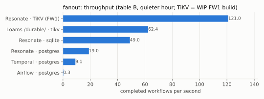
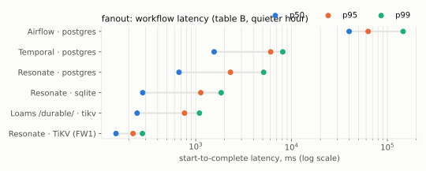

## Results: TiDB Cloud Starter, seven regions

The API offers Starter in seven regions (`GET /v1beta1/regions`: AWS Oregon, N. Virginia, Singapore, Tokyo,
Frankfurt, São Paulo; Alibaba Cloud Singapore), not five; all seven ran, one cluster at a time. The Resonate server
ran on this laptop against each region over TLS, so **every number includes the WAN**. Tables: the traced pass
(FW10 build, 2026-10-25); the untraced pass of 2026-10-24 (`loams/main` `f419b8be`) is in `results.md` and agrees
within the noise. Sizes: fanout 40 workflows (4 in flight), chain 20 (10 in flight), burst 50.

TIDB_SECTION

## Timers

Sleep lateness (wake-up observed − due time) from the chain runs, p50 / p99:

TIMERS_TABLE

The rows are the chain runs of tables A and B. The SQL stores (SQLite, Postgres, MySQL/TiDB) are affected by the timer-wheel bug FW10 found: after task load the
deadline wheel falls behind (`resonate-timer-wheel`, default `WHEEL_CAPACITY=8192`); the fix is fork task FW11 and
had not landed when these ran, so these SQL timer numbers are not a property of the design. The TiKV store and the
Loams 0.1.1 engine (TiKV) also fire late; that is not explained by FW11 and is reported to the fork lead.
Temporal's timers fire about 1 s late at minimum by design (sub-second sleeps round up), which is why S = 1 s here.

## Cost

COST_SECTION

## Traces and SigNoz

Representative traces (the run's median workflow), from SigNoz:

| | |
|---|---|
| Raw Resonate on SQLite, fan-out: client → gateway → `process` → `sqlite.transact` | 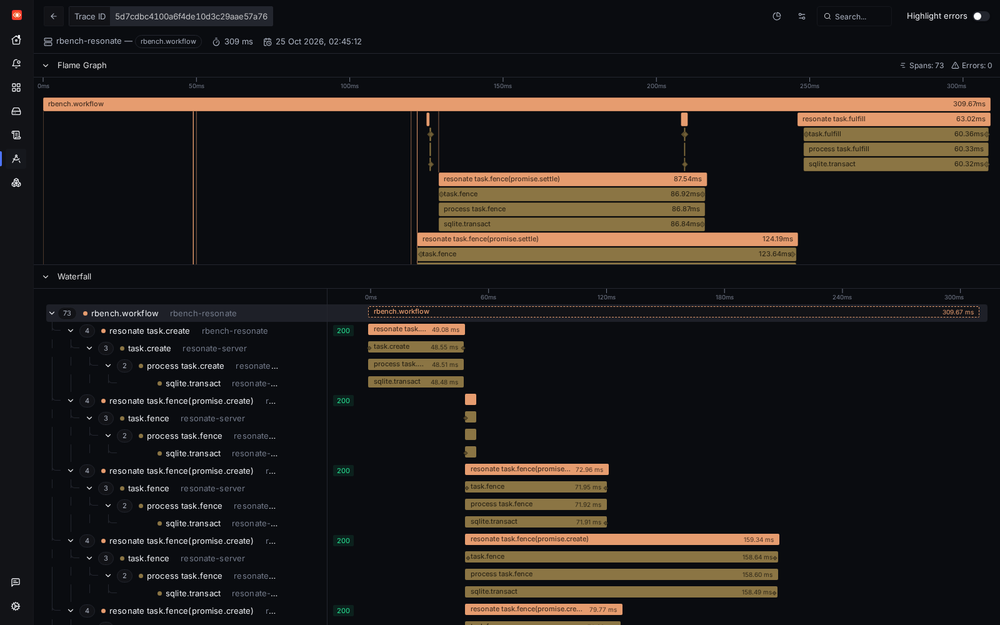 |
| Raw Resonate on TiDB Cloud Singapore, fan-out: the 8 parallel settles serialize (18-20 s `mysql.transact` each) | 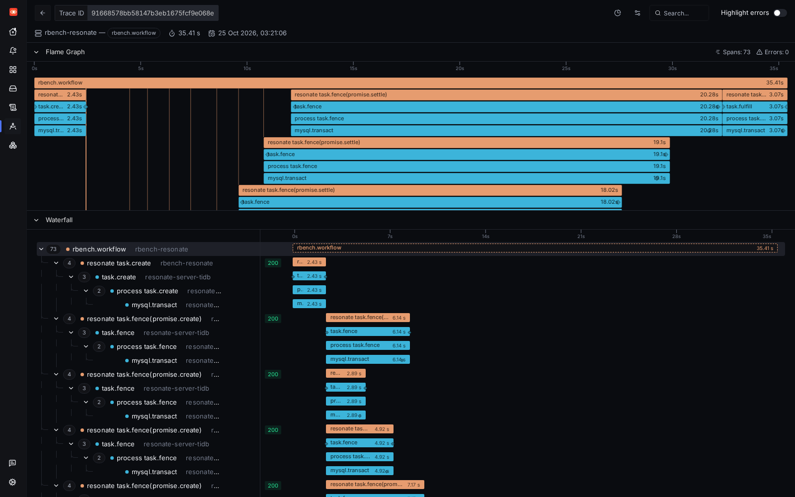 |
| Raw Resonate on TiDB Cloud Singapore, chain | 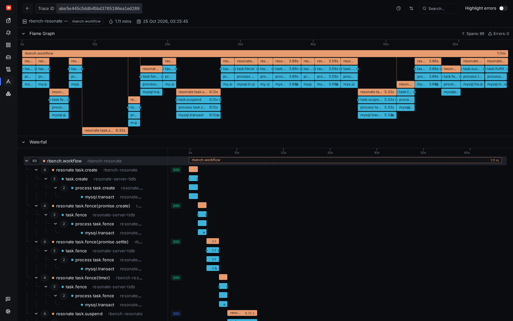 |
| Raw Resonate on Postgres, chain (timers, suspend, re-acquire) | 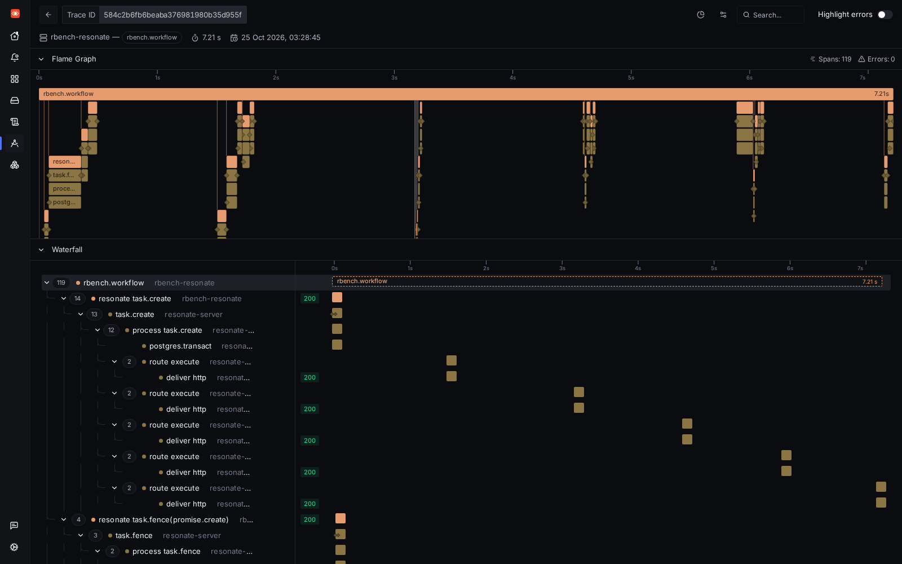 |
| Raw Resonate on TiKV (final build), fan-out: client → gateway → `process` → `resonate.blob.batch` → `blob.get`/`blob.put` | 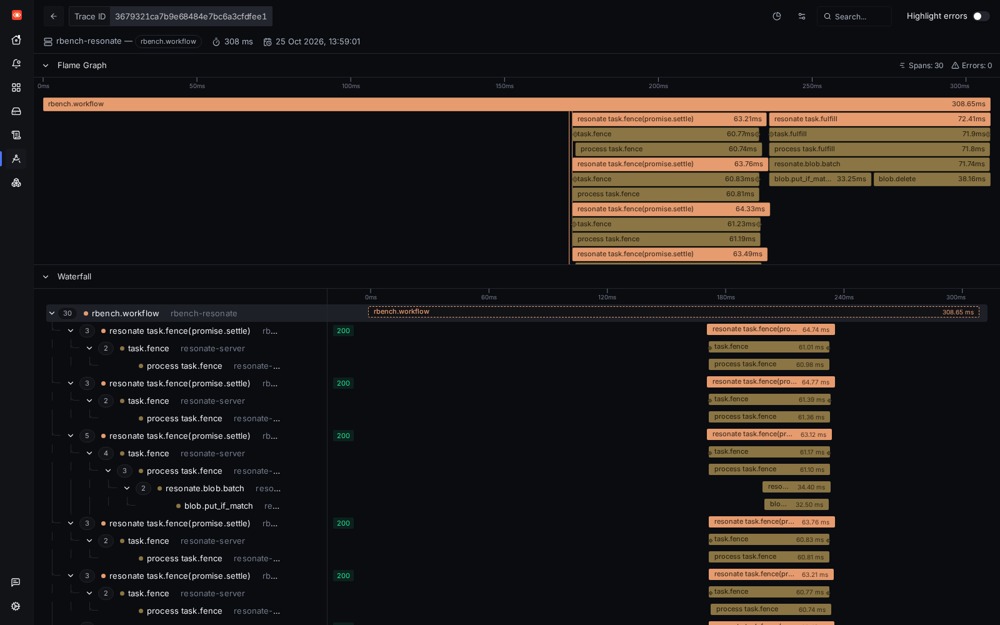 |
| Raw Resonate on TiKV (final build), chain: each wake-up (`route execute` → `deliver http`) lands seconds after its 1 s timer | 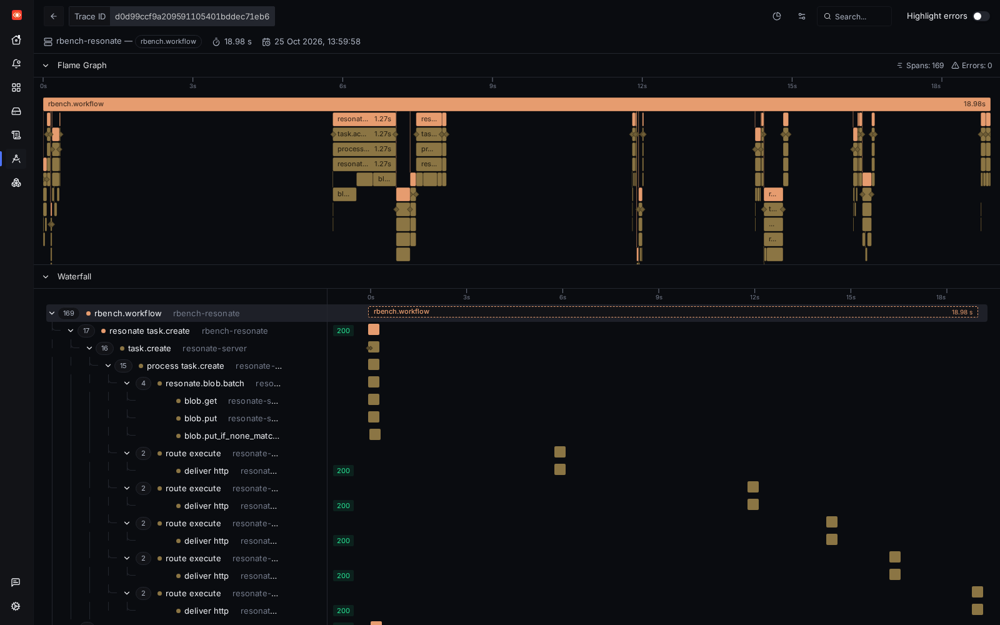 |
| Raw Resonate on TiKV (WIP FW1 build), fan-out (client spans only) | 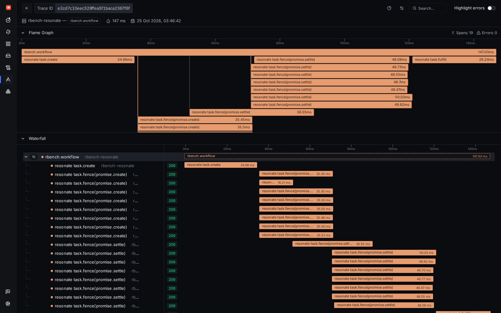 |
| Raw Resonate on TiDB Cloud N. Virginia, fan-out | 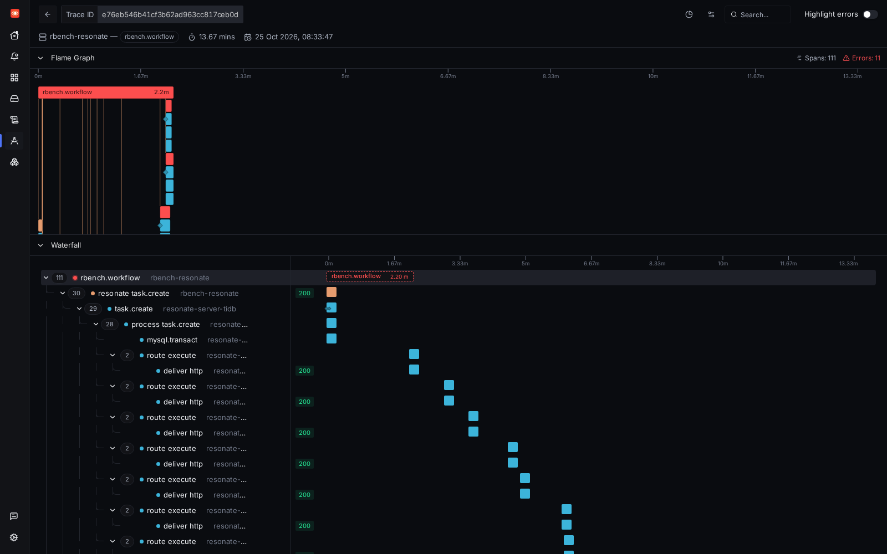 |
| Loams 0.1.1 `/durable/` on TiKV, chain (client spans) | 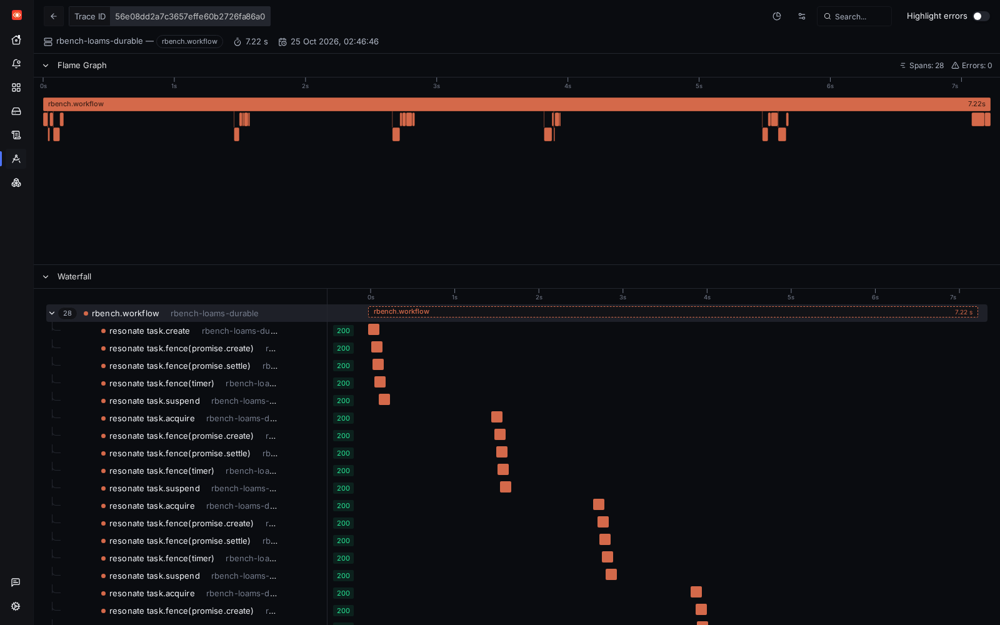 |
| Stock Temporal, fan-out (Go SDK interceptor spans) | 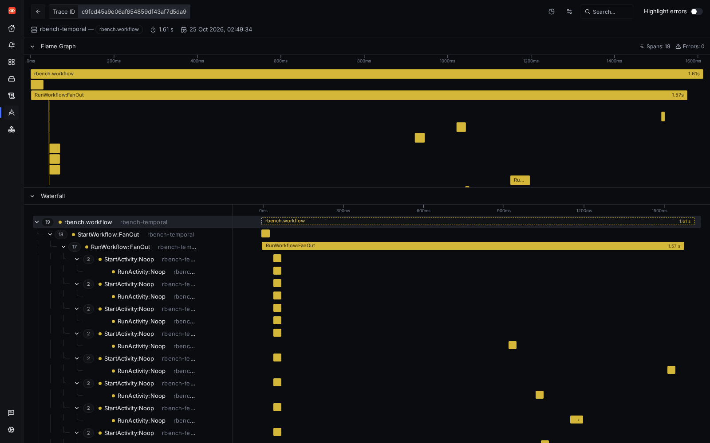 |
| Airflow, fan-out (rbench's REST calls) | 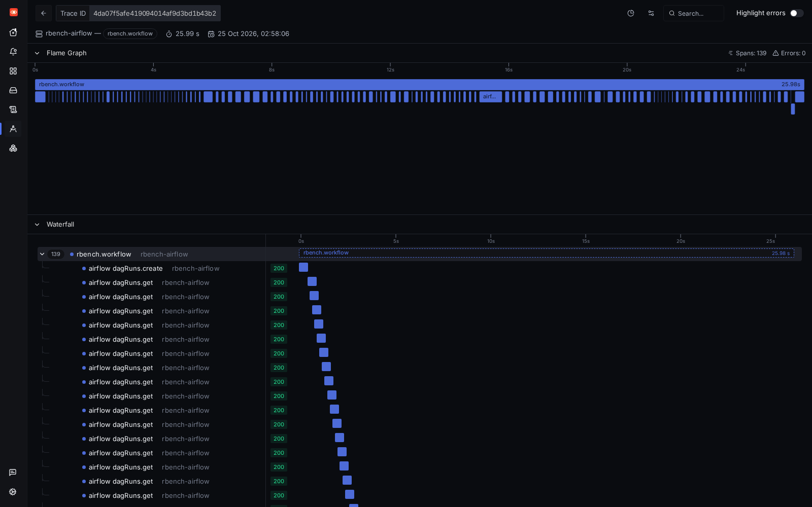 |
| Service map | 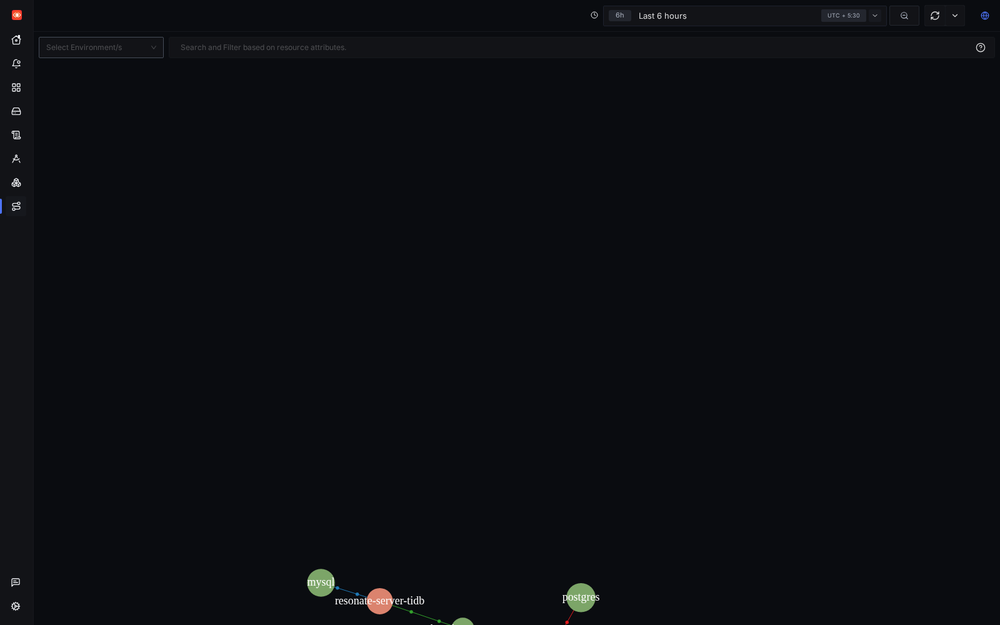 |
| Services (p99, error rate, ops/s) | 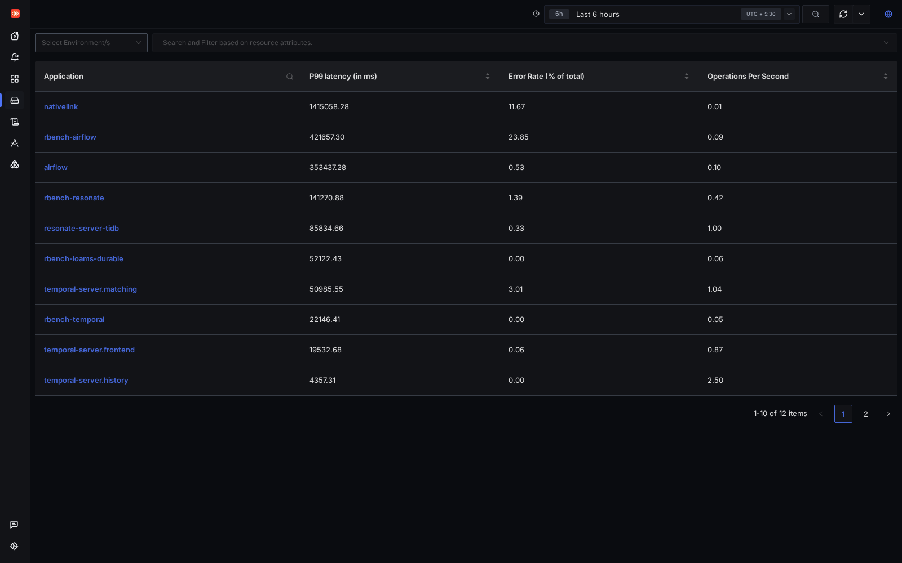 |

There is no "Temporal via gateway" trace: that leg did not run. Temporal's server exported its own spans
(`temporal-server.{frontend,history,matching,worker}`, about 37,000 traces), but none of them joined the SDK's
traces in these runs, so the Temporal screenshot shows the SDK side only. Airflow exported its own spans as service
`airflow`; they do not continue rbench's trace either (rbench passes `traceparent` in the Dag run's `conf`, which
Airflow does not read).

**Reproduce the views.** `podman compose -p rbench-signoz -f bench/stacks/signoz/compose.yaml up -d`, open
<http://127.0.0.1:13301>, create the first user, then either run the legs (they export to 127.0.0.1:4317) or replay
the files in `traces/` into the collector. The screenshots come from `bench/scripts/pick-traces.py` (the median
`rbench.workflow` of each run) and `bench/scripts/shots.js` (playwright-core 1.63.0); `screenshots/spec.json` lists
the trace IDs. SigNoz's own counts can include duplicates (the collector retries into it); the span files do not.

## Caveats

- **One laptop, shared.** Client, server, store and the trace pipeline share 14 cores with other agents' builds.
  The same leg varied a lot between a busier and a quieter hour (SQLite burst: 19/s with the server at 5% CPU
  waiting on fsync, then 184/s). Compare legs within one table, and check the load column.
- **One node of everything.** TiKV, PD, Postgres and TiDB ran as single nodes; replication factor 1 for TiKV.
- **WAN to TiDB Cloud.** The Starter numbers are dominated by ~300 ms round trips from India; they are not what a
  Resonate server in the same cloud region would see. Free-tier throttling could not be told apart from WAN latency
  (Starter exposes no RU or throttling metrics to an API key).
- **Request Units are estimated** (see Cost): Starter does not let a user read RU consumption, so they were measured
  on a local TiDB and scaled by per-statement ratios measured on Starter.
- **The host's load varied from 14 to over 200** while these ran (other agents' builds; one reboot). The same leg
  moved a lot between hours (raw Resonate on TiKV fan-out: 121/s at load 20, 37-49/s at load 26-40; SQLite burst
  19/s to 184/s). Runs cut by a reboot or a network outage are in `runs-interrupted/` and were run again.
- **The WIP FW1 build** hit region errors on a fresh TiKV; the merged build did not.
- **Airflow** answered 500 to many of rbench's status polls (2,168 in the 100 ms pass, 451 in the 1 s pass) and
  could not take a 500-run burst in either pass; a 100-run burst completed 92/100 with a p50 of 21 minutes (100 ms
  polling, `results.md`).
- **Not like for like everywhere.** Raw Resonate here is a protocol-level worker in the load generator (no SDK
  overhead); Temporal includes its SDK worker; Airflow includes its scheduler and task start-up per step.

## Cloud resources

TIDB_RESOURCES

## Files

- `runs/<run-id>/`: `summary.json`, `workflows.csv`, `steps.csv`, `requests.csv`, `resources.csv`, `env.json`,
  (Goose's HTML report came out empty with `NoPrintMetrics` set and is not included.)
- `runs-interrupted/`: runs cut by a network outage or a reboot of the host, excluded and run again.
- `results.csv`, `results.md`: every run. `headline-runs.txt`: the runs in the tables above.
- `tidbcloud-rtt.json`, `ru-per-workflow.json`, `ru-spot-check.{sql,txt}`, `cost.json`, `cost.md`.
- `traces/`: spans, `manifest.json` with counts per service. `charts/`, `screenshots/`.

Reproduce: `bench/scripts/run-local-all.sh`, `bench/scripts/run-tidbcloud.sh <region>`,
`bench/scripts/measure-ru.sh`, then `rbench report`, `bench/scripts/{headline,cost,charts}.py`.
