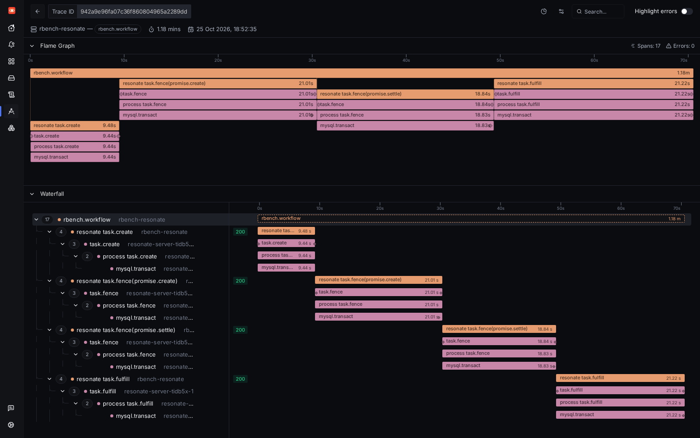
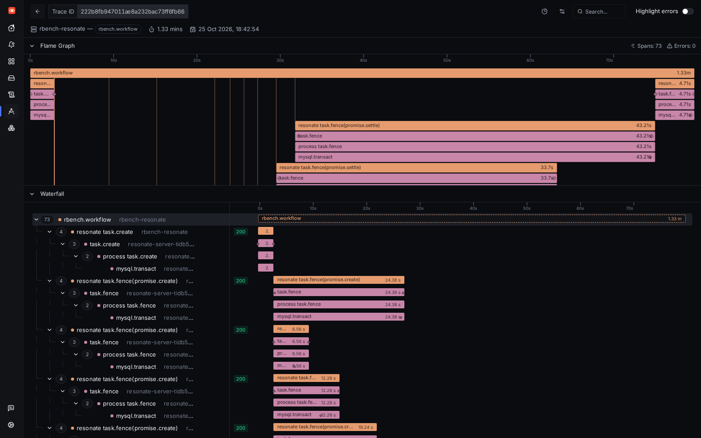

# Five TiDB Cloud Starter instances at full (2026-10-25)

The owner's question: how many workflows per second can five free Starter instances do together? Five independent
Resonate servers (final `loams/main` `4656e2fd`, MySQL/TiDB store, FW10 tracing on) ran on this laptop, each on its
own Starter instance, and five rbench processes drove them in parallel with the same workloads as the main run
(fan-out: 8 parallel steps per workflow; burst: N one-step workflows started at once). Concurrency went up in steps
until throughput stopped rising or errors appeared. Scripts: `bench/scripts/run-tidb-5x.sh` and
`bench/scripts/tidb5x.py`; per-instance runs in `runs/`, per step in `combined.jsonl`.

**Region.** `aws-ap-southeast-1` (Singapore). TCP connect times mislead from here (some handshakes are answered by a
proxy in a few ms), so one instance was created in each of the three candidate regions and timed with 30 `SELECT 1`
over one MySQL/TLS session ([`rtt-pick.txt`](rtt-pick.txt)): Singapore AWS min 96 / p50 205 ms, Singapore Alibaba
134 / 208 ms, Tokyo 189 / 350 ms. The two other instances were deleted at once.

## Results

Combined wf/s = all completed workflows of the five instances / (last end − first start).

| Pass (pool per server) | Workload | In flight per server (×5) | OK / started | Combined wf/s | Per instance wf/s | p50 ms | p99 ms | Failed | Request errors |
|---|---|---|---:|---:|---|---:|---:|---:|---:|
| 1 (64) | fanout | 4 | 34/40 | 0.21 | 0.04 / 0.04 / 0.05 / 0.04 / 0.04 | 53,453 | 109,988 | 6 | 8 |
| 1 (64) | fanout | 16 | 158/160 | 1.06 | 0.23 / 0.22 / 0.22 / 0.21 / 0.23 | 52,407 | 92,063 | 2 | 2 |
| 1 (64) | fanout | 64 | 110/640 | 0.32 | 0.06 / 0.06 / 0.05 / 0.17 / 0.07 | 100,336 | 126,718 | 530 | 2392 |
| 1 (64) | burst | 50 | 250/250 | 17.21 | 3.62 / 3.51 / 3.50 / 4.32 / 3.45 | 10,530 | 14,235 | 0 | 0 |
| 1 (64) | burst | 200 | 1000/1000 | 17.30 | 3.56 / 3.52 / 3.48 / 3.59 / 3.47 | 50,833 | 57,175 | 0 | 0 |
| 1 (64) | burst | 500 | 2500/2500 | 27.92 | 5.90 / 5.88 / 5.59 / 5.92 / 5.77 | 76,443 | 88,265 | 0 | 0 |
| 2 (256) | fanout | 16 | 150/160 | 0.86 | 0.17 / 0.17 / 0.17 / 0.17 / 0.17 | 60,821 | 114,307 | 10 | 10 |
| 2 (256) | fanout | 32 | 99/320 | 0.28 | 0.04 / 0.07 / 0.04 / 0.07 / 0.07 | 100,361 | 160,922 | 221 | 1315 |
| 2 (256) | fanout | 64 | 259/640 | 0.84 | 0.11 / 0.86 / 0.14 / 0.00 / 0.28 | 72,884 | 107,650 | 381 | 484 |
| 2 (256) | burst | 500 | 934/2500 | 3.37 | 0.42 / 0.34 / 1.17 / 5.40 / 0.22 | 74,059 | 76,830 | 1566 | 1747 |
| 2 (256) | burst | 1000 | 1180/5000 | 13.80 | 1.40 / 11.70 / 0.38 / 0.18 / 1.49 | 78,133 | 84,794 | 3820 | 3854 |

**At full: about 28 one-step workflows/s and about 1.1 fan-out workflows/s, combined.**

- **Burst:** 27.9 wf/s with 500 starts per instance (2,500 at once); 17.3 wf/s at 50 and 200 per instance. All 3,750
  workflows of pass 1 completed.
- **Fan-out:** best at 16 in flight per instance (80 in total): 1.07 wf/s, p50 52 s. At 64 in flight per instance
  each server's 64-connection pool ran out (528 "pool timed out" errors), and throughput fell to 0.3 wf/s.

**Throttling: none seen.** No MySQL error 8252 ("Exceeded resource group quota limitation") and no refused
connection in any of the ten server logs; every failure has a client-side cause:

- **Pass 1 (pool 64):** client pool timeouts.
- **Pass 2 (pool 256):** 1,280 TLS connections from one laptop. The home network gave out: 2,364 "No route to
  host (os error 113)", plus "peer closed connection without sending TLS close_notify", and pool timeouts behind them.

So the ceiling measured here is the client: one laptop's connection pool and network over a ~200 ms round trip. It
is not Starter. A Resonate server in the same region as its instances would see round trips in single-digit
milliseconds and should do far more, but that was not measured.

One burst workflow on instance 1 (500 started at once per instance). Each request's `mysql.transact` takes 9-21 s,
most of it spent waiting for one of the server's 64 connections.

Also in `screenshots/`: a pass-2 burst trace (pool 256).

## What the free tier sustains

Free per instance per month: 50 M Request Units (first five instances of an organization), so 250 M for five.
Measured cost ([`../ru-per-workflow.json`](../ru-per-workflow.json), estimated, see the main README's Cost
section): ~737 RU per fan-out workflow, ~150 RU per one-step workflow.

| Workload | Workflows / month in 250 M RU | Average wf/s over a 730 h month | At the measured full rate | The month's allowance lasts |
|---|---:|---:|---:|---:|
| fan-out (8 steps) | 339,213 | 0.129 | 1.07 wf/s ≈ 789 RU/s | 88 h (3.7 days) |
| one-step (burst) | 1,666,667 | 0.634 | 27.9 wf/s ≈ 4,185 RU/s | 17 h (0.7 days) |

With a spending limit of 0, running past the allowance is not charged: Starter throttles the instance until the next
month. This run used a small part of it: pass 1 and 2 together completed 6,615 workflows
(1,476,570 RU at those rates, failed attempts excluded).

## Instances

Five per pass, all `rbench-aws-ap-southeast-1-<time>-<n>`, label `rbench=1`, spending limit 0, created and deleted by
`run-tidb-5x.sh` (deletion by id, then the list checked empty); plus the three region-pick instances. Every id with its
creation and deletion is in [`../tidbcloud-created.tsv`](../tidbcloud-created.tsv) and
[`../tidbcloud-deleted.tsv`](../tidbcloud-deleted.tsv). Pass 1 ids: 10333919004759919027, 10296688288587420163, 10813386737015526916, 10867370682247382230, 10525189431439768244. Pass 2 ids: 10949425420474333795, 10190826083799075074, 10230745242719492474, 10015293480921902990, 10170260578944764732.
